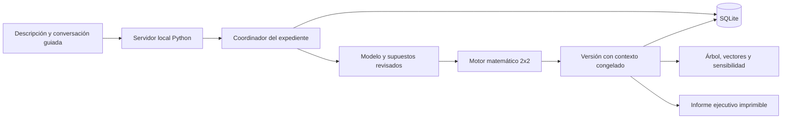

# Arquitectura de Escenarios TJ

Estado al 5 de octubre de 2026: primera entrega del coordinador guiado (etapas A y B). La aplicación existente sigue funcionando. Primera integración de IA local implementada; juegos secuenciales, agentes autónomos, PDF propio directo y empaquetado están pendientes.

## Flujo implementado

Python calcula y persiste; HTML/CSS/JavaScript presenta los resultados. La ejecución base usa la biblioteca estándar y no necesita Node ni un servicio externo.

## Coordinación y estados

Un expediente tiene UUID, revisión, descripción, conversación, respuestas estructuradas, borrador del modelo, referencias de evidencia y supuestos. Los estados son:

| Estado | Condición | Siguiente acción |
|---|---|---|
| `collecting` | Faltan respuestas de preparación | Registrar objetivo, horizonte, datos conocidos, fundamento de pagos y de probabilidades |
| `modeling` | Preparación completa, modelo todavía sin cálculo vigente | Completar actores, estrategias, pagos, fuentes y supuestos; revisar |
| `calculated` | Modelo válido y revisión confirmada | Explorar gráficos, consultar informe o generar otra versión |

La guía pregunta; no interpreta automáticamente el texto. No propone entidades inferidas ni pagos inventados. El analista define un juego simultáneo de dos actores y dos estrategias. En expedientes nuevos, actores, estrategias y pagos están vacíos. Las probabilidades comienzan en 50 % / 50 % como supuesto exploratorio visible, que requiere revisión antes de calcular.

Cada respuesta se guarda inmediatamente. El borrador del modelo se guarda mediante un botón explícito. Los campos sin guardar se pierden al recargar o cambiar de expediente. Cambiar datos en la interfaz invalida la revisión y oculta los resultados vigentes hasta recalcular; guardar un borrador conserva las versiones calculadas anteriores.

## Persistencia y versiones

`workflows` conserva el estado editable; `workflow_versions` conserva resultados inmutables en la API, numerados por expediente. Cada versión contiene matrices, parámetros, escenarios, sensibilidad, conversación, descripción, respuestas, fuentes, supuestos y fecha de revisión.

Las operaciones de cambio ejecutan una transacción SQLite `BEGIN IMMEDIATE`. El cliente debe enviar la revisión actual. Una revisión desactualizada devuelve HTTP 409 sin sobrescribir datos. Una entrada incompleta o un cálculo sin revisión falla antes de confirmar la transacción.

La interfaz recupera el último expediente mediante su ID en localStorage; los datos y resultados están en SQLite, no en localStorage. El historial muestra hasta treinta expedientes recientes, sus versiones y matrices libres anteriores.

Aplicar sensibilidad a un expediente produce una nueva versión del mismo expediente, conserva sus fuentes y registra el cambio de probabilidad en los supuestos. Un informe histórico muestra el contexto de su versión sin modificar el borrador activo.

## Módulos

| Módulo | Responsabilidad |
|---|---|
| `escenarios/workflow.py` | Preguntas guiadas, validación de borradores, referencias de evidencia, estados y versiones transaccionales |
| `escenarios/case_model.py` | Validación y cálculo de juegos propios 2x2; equilibrios puros, un mixto interior aislado, sensibilidad y umbral |
| `escenarios/core.py` | Ejemplo institucional independiente |
| `escenarios/server.py` | API y recursos estáticos en loopback; comprobación de Host y Origin |
| `escenarios/graph.py` | Red manual de entidades y relaciones, separada del motor de pagos |
| `escenarios/report.py` | PDF vectorial del ejemplo institucional; ReportLab opcional |
| `escenarios/intake.py` | Adaptador de borrador de IA del prototipo; todavía no integrado al coordinador |
| `web/workflow.js` | Conversación, fuentes, revisión, recuperación e informes con contexto |
| `web/case.js` | Editor matemático para expediente o matriz libre |
| `web/case-visuals.js`, `web/sensitivity.js` | Gráficos del caso calculado, versiones y sensibilidad |

## Contratos de API

- GET `/api/workflows`: expedientes recientes.
- GET `/api/workflows?id=<uuid>`: expediente y lista de versiones.
- GET `/api/workflows?id=<uuid>&version=<n>`: resultado y contexto de una versión.
- POST `/api/workflows`: acciones `create`, `message`, `draft` y `calculate`.
- `create` requiere nombre y descripción. Las otras acciones requieren ID y revisión.
- `draft` permite pagos pendientes (null), sin producir resultados.
- `calculate` requiere las cinco respuestas, un modelo matemático completo, supuestos escritos y `reviewed: true`. Siempre guarda una versión.
- Fuentes: máximo veinte referencias con nombre, ubicación y dato respaldado; se identifican como aportadas por el analista y no verificadas automáticamente.
- Se conservan `/api/cases`, `/api/history`, `/api/snapshots`, `/api/graph`, `/api/analysis`, `/api/intake` y `/api/report.pdf` para las funciones previas.

## Evidencia, gráficos e informes

Las referencias son texto, sin descarga ni ejecución de archivos. Los hechos aportados no se consideran verificados por haberse escrito en el chat. Los supuestos no se convierten en evidencia. Las fuentes y los textos se escapan al incorporarlos a HTML/SVG.

El árbol propio descompone consecuencias simultáneas, no es un juego secuencial resuelto. Los vectores muestran utilidad con escala común, no probabilidad. La sensibilidad mantiene los pagos y explora la conducta supuesta de B; el umbral de indiferencia no constituye por sí solo un equilibrio de Nash.

El informe propio incluye problema, objetivo, horizonte, datos pendientes, fundamentos, fuentes, supuestos, método, matrices, equilibrios, escenarios, sensibilidad, límites y próximos pasos. Por ahora, se imprime o guarda como PDF desde el navegador; su paginación final sigue pendiente de validación. La descarga directa de PDF sigue siendo exclusiva del ejemplo.

Las demostraciones se conservan en secciones desplegables independientes para evitar mezclar sus resultados con el expediente. No se calcula una predicción a partir de vínculos de una red decorativa.

## Próximas entregas

C. Adaptador local Ollama y coordinación asistida: inspeccionar RAM, GPU y espacio; verificar procedencia, licencia y requisitos del modelo antes de recomendarlo. Salidas estructuradas, revisión del analista y validación del motor Python. Modo guiado disponible ante fallos. Sin descargas grandes ni instalación de servicios sin presentar antes los componentes concretos.

D. Juegos secuenciales auténticos, escenarios ampliados, agentes con reglas trazables y Monte Carlo reproducible. Definir métodos y distribuciones antes de simular; no atribuir precisión predictiva sin evaluación.

E. PDF propio directo con revisión visual, lanzador Windows, recursos y datos persistentes separados, empaquetado reproducible y comprobación en un equipo sin Python.

Para evaluación predictiva, separar datos de desarrollo y evaluación, utilizar una referencia simple y definir métricas para el resultado previsto. La versión actual calcula bajo supuestos; no ofrece predicción calibrada.

## Alcance de ejecución

Servidor local para un usuario, datos en `data/`, excluidos de Git. No exponer en Internet sin autenticación, autorización y un servidor apropiado. No se descargaron modelos ni se instaló un motor de IA para esta entrega.

El código de aplicación es propio: no se copiaron implementaciones, prompts ni imágenes de Miro-Fish. La licencia de distribución del proyecto queda pendiente de elección.

## IA local — primera entrega C

`local_ai.py` conecta exclusivamente con Ollama en loopback, sin proxies ni redirecciones. La configuración se guarda en SQLite. El catálogo de esta entrega admite Mistral 7B v0.3 Q4_K_M, publicado por Mistral AI con licencia Apache-2.0, con digest revisado. Un cambio de digest requiere revisar la versión antes de habilitarla. No se utiliza un modelo de familia Qwen ni un proveedor remoto.

`ai_jobs.py` ejecuta una generación en segundo plano y conserva estado, errores, modelo, digest, contrato y resultado. GET `/api/ai/status` comprueba disponibilidad; POST `/api/ai/config` configura activación; POST `/api/ai/jobs` inicia una solicitud con ID/revisión del expediente; GET `/api/ai/jobs?job=<id>` o `?workflow=<uuid>` consulta resultados.

Se solicita JSON Schema a `/api/chat` y se valida otra vez en Python. El esquema admite resumen, dos actores, dos estrategias por actor, variables propuestas, preguntas, hipótesis y límites. No admite pagos, probabilidades, código ni herramientas. La validación asegura la estructura y límites; no certifica la veracidad del contenido generado.

La acción `accept_ai` exige que la propuesta corresponda al expediente y a su revisión original. Registra su procedencia, incorpora nombres y estrategias al borrador y deja pagos y probabilidades sin modificación. La revisión del analista sigue siendo obligatoria. Las versiones calculadas conservan las propuestas aceptadas en su contexto y las muestran separadas de la evidencia en el informe.

Una generación por proceso, timeout de 240 segundos, 600 tokens de salida solicitados y contexto de 4096 tokens. Se envían extractos acotados y se registra `context_limited`. No se ejecutan instrucciones procedentes de textos o del modelo. Si el servicio no está disponible o la estructura falla, el expediente y el modo guiado permanecen utilizables.

Equipo inspeccionado por consultas de solo lectura: 24509800448 bytes de RAM (22,8 GiB), AMD Radeon integrada con 1 GiB reportado y aproximadamente 445 GiB libres en C. Ollama 0.35.1 ya instalado. Mistral pesa 4372824384 bytes (4,4 GB); no se descargó. La memoria reportada del adaptador integrado no equivale necesariamente a toda su memoria compartida disponible; el rendimiento se evalúa con inferencia real.

Procedencia y contratos: https://huggingface.co/mistralai/Mistral-7B-Instruct-v0.3 y https://docs.ollama.com/api/chat. Licencia Apache confirmada también mediante `ollama show mistral:latest --license`. Esta integración usa un modelo instalado; no distribuye sus pesos.

Cada nueva propuesta registra el extracto enviado, el modelo actual, los supuestos, las opciones de generación y la versión del mensaje del sistema. Las respuestas históricas pueden discrepar del borrador: la IA debe señalarlo y el analista revisar. La conformidad del esquema no garantiza exactitud semántica. Cambiar el significado de estrategias exige revisar los pagos aunque el sistema conserve sus valores.
