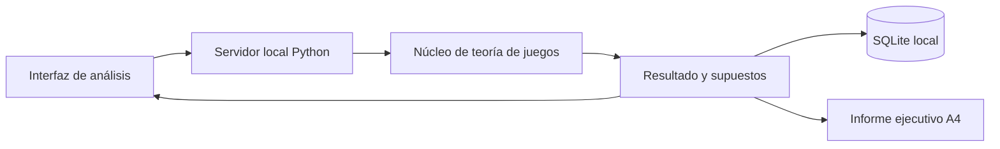

# Diseño propuesto para Escenarios TJ

Estado: versión 0.1 local implementada el 5 de octubre de 2026. Las etapas avanzadas siguen pendientes.

## Arquitectura implementada

Se sustituye la propuesta de Streamlit por una interfaz a medida para controlar la mesa de análisis y su salida ejecutiva. Python realiza cálculos, persistencia y PDF; HTML/CSS y JavaScript presentan resultados e interacción en el navegador. La base no requiere Node ni servicios externos para ejecutarse.

| Módulo | Responsabilidad |
|---|---|
| `escenarios/core.py` | Parámetros validados, matrices, valores esperados, equilibrios puros y comparación de tres escenarios. |
| `escenarios/storage.py` | Instantáneas transaccionales en SQLite; cierre explícito de conexiones. |
| `escenarios/server.py` | Recursos permitidos y API en loopback. Restricción de Host y origen en escrituras. |
| `escenarios/report.py` | Informe vectorial A4 de dos páginas; ReportLab opcional. |
| `web/` | Actores seleccionables, matriz, árbol, escenarios, historial y vista imprimible. |

Contratos: GET `/api/analysis?q=0.6&cost=3`, POST `/api/snapshots` con parámetros JSON, GET `/api/history` y GET `/api/report.pdf?q=0.6&cost=3`. q entre 0 y 1, cost entre 0 y 6; rechazar no finitos. Historial: últimas veinte instantáneas, ID, fecha UTC y resultado completo. Datos en `data/`, fuera de Git.

La versión actual es un caso ilustrativo fijo de dos actores y estrategias simultáneas. No incluye aún agentes autónomos, editor libre de matrices, juego extensivo resuelto ni pronósticos calibrados. El árbol muestra consecuencias bajo el supuesto de conducta de B.

El servidor estándar está destinado a uso local. Antes de uso compartido se requieren servidor de despliegue, autenticación, autorización y controles de recursos. No exponer esta versión en Internet.

El código de aplicación es propio: no se copiaron implementaciones, prompts ni imágenes de Miro-Fish. La licencia de distribución del proyecto queda pendiente de elección.

## Objetivo

Chat inicial: POST `/api/intake` recibe una descripción de hasta 12000 caracteres. En modo guiado devuelve una estructura de preguntas, variables y escenarios genéricos; no interpreta el caso ni cambia los cálculos. Hay un adaptador opcional compatible con chat/completions mediante MODEL_BASE_URL, MODEL_NAME y MODEL_API_KEY, con validación de estructura y salida insertada como texto. No está configurado en esta instalación: el usuario eligió continuar sin IA. La interpretación automática y formalización matemática completas siguen pendientes.

Avance del editor de redes: el panel permite crear una red propia de hasta 200 entidades y 1000 relaciones, guardarla en SQLite y recuperarla al abrir la aplicación. Los nombres se escapan al dibujarse en SVG. La red del analista permanece separada de la matriz ilustrativa; todavía no se calculan estrategias a partir de sus vínculos. Actualmente se conserva una red propia por instalación, sin historial de versiones de esa red.

Explorar escenarios documentados mediante agentes, contrastar alternativas y producir informes trazables en español. La aplicación se implementará en Python. Una interfaz de navegador seguirá renderizando HTML/CSS; no se necesita mantener el frontend Vue ni una cadena Node.

## Componentes

- Interfaz a medida de navegador servida por Python, para análisis, configuración, seguimiento e informes.
- Núcleo Python independiente de la interfaz: documentos, actores, relaciones, eventos, escenarios y ejecuciones, con esquemas validados.
- SQLite local para metadatos, actores, relaciones, eventos y estados; archivos confinados en un directorio de datos para documentos.
- Adaptadores LLM sustituibles: proveedor remoto elegido por el usuario o servidor local. Sin proveedor chino predeterminado y sin Zep obligatorio. Modo de demostración sin claves, claramente identificado como tal.
- Motor de rondas propio: selección de agentes, decisiones estructuradas, memoria acotada, registro de eventos y límites de agentes, rondas, llamadas, tiempo y costo. El costo remoto es estimado salvo datos efectivos del proveedor.
- Generador de informes que referencia documentos y eventos concretos, separando supuestos de resultados simulados.

## Etapas y criterios de aceptación

1. Base local: crear proyectos, ingresar TXT/Markdown, definir actores manualmente y ejecutar un caso de demostración. Debe funcionar sin red ni claves y persistir después de reiniciar.
2. Documentos y grafo: incorporar PDF, conservar origen y fragmentos, permitir corregir entidades/relaciones antes de simular. Ninguna afirmación extraída debe perder su referencia.
3. Agentes con LLM: configurar proveedor/modelo, estimar presupuesto, generar perfiles revisables, ejecutar/cancelar rondas y registrar llamadas. Los límites deben cortar la ejecución y los fallos deben quedar registrados.
4. Comparación: bifurcar escenarios, introducir eventos y comparar métricas definidas por el usuario; ejecutar réplicas y registrar variabilidad.
5. Informes e interacción: exportar resultados, explicar evidencia y conversar con actores simulados sin confundirlos con personas reales.
6. Validación: usar casos históricos con separación temporal, métricas apropiadas y comparación con una base simple antes de hablar de capacidad predictiva.

## Decisiones pendientes

Definir el primer caso de uso, tamaño esperado de las simulaciones y proveedor/modelo disponible. Empezar con una instalación local para un usuario. Autenticación y permisos son requisitos previos a cualquier exposición compartida.

La auditoría y la versión local inicial son los entregables actuales. Las etapas anteriores describen la evolución prevista, no capacidades ya completadas. No se pretende paridad con Miro-Fish.

Los resultados de /api/cases se transfieren a case-visuals.js como una copia del último cálculo. Esta copia alimenta árbol, vectores e informe propio. Editar el formulario requiere recalcular para actualizarla. El selector de informe distingue el ejemplo y el caso propio; imprimir usa el contenido seleccionado.
